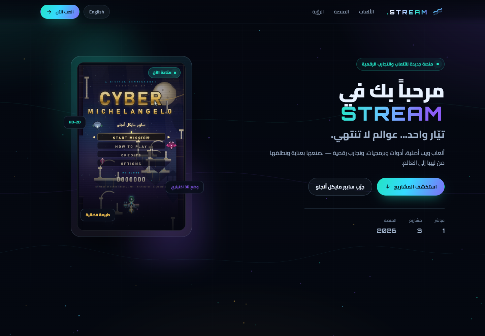

# STREAM · stream.com.ly

**منصة ألعاب وتجارب رقمية** — بوابة خفيفة (HTML/CSS/JS فقط، بدون build) تجمع المشاريع المباشرة والقادمة في مكان واحد.
**A games & digital experiences platform** — a zero-build static portal for live and upcoming projects.

> الحالة: الواجهة الأمامية جاهزة للمراجعة. أول مشروع مباشر: **Cyber Michelangelo**.
> الصفحة مصمّمة للاستضافة على **Cloudflare Pages** على النطاق `stream.com.ly`.



<p align="center">
  
</p>

---

## المحتوى الحالي · What's inside

| المشروع | الحالة | الرابط |
| --- | --- | --- |
| **Cyber Michelangelo** — HD-2D shmup + وضع 3D اختياري | 🟢 مباشر | <https://ly.id.ly/Cyber-Michelangelo/> |
| **لعبة السيارات** — مشروع سباقات قادم | 🔒 قريباً | — |
| **لعبة الدراجات النارية** — مشروع قادم | 🔒 قريباً | — |

المنصة مهيّأة لإضافة المزيد لاحقاً: ألعاب، أدوات ويب، وتطبيقات صغيرة.

---

## بنية المشروع · Project structure

```
index.html               الصفحة الرئيسية (عربي افتراضي + إنجليزي)
assets/
  css/style.css          الهوية البصرية الداكنة + التخطيط المتجاوب + RTL/LTR
  js/app.js              تبديل اللغة، الحركات، الخلفية المتحركة، بطاقات «قريباً»
  img/                   لقطات Cyber Michelangelo (بطاقة + مشروع مميز + hero)
_headers                 أمان + كاش (Cloudflare Pages)
_redirects               مختصرات /play و/cyber وغيرها (Cloudflare Pages)
404.html                 صفحة خطأ بهوية المنصة
robots.txt / sitemap.xml تحسين الظهور في محركات البحث
CNAME                    احتياطي إن استُخدم GitHub Pages بدلاً من Cloudflare Pages
server.mjs               خادم محلي بلا اعتماديات للمعاينة فقط
```

---

## المعاينة محلياً · Local preview

```bash
node server.mjs          # → http://127.0.0.1:5180
```

أو أي خادم ملفات ثابت (مثلاً `npx serve .`). لا حاجة لأي `npm install`.

---

## النشر على Cloudflare Pages · Deploy

1. **اربط المستودع:** Cloudflare Dashboard → *Workers & Pages → Create → Pages → Connect to Git* → اختر `Gamingmonster2/stream.com.ly-`.
2. **إعدادات البناء:**
   - Framework preset: **None**
   - Build command: *(اتركه فارغاً — لا يوجد build)*
   - Build output directory: **`/`**
3. **النطاق المخصص:** بعد أول نشر → *Custom domains → Set up a custom domain* → `stream.com.ly`.
   - Cloudflare سيضيف سجل DNS تلقائياً (CNAME إلى `<project>.pages.dev`) ويصدر شهادة SSL.
   - ⚠️ حالياً يشير `stream.com.ly` إلى GitHub Pages **غير المنشور** (يرجع 404). عند ربط Pages يجب أن يحل سجل Pages محل السجل القديم.
4. **SSL/TLS:** اختر *Full (strict)* وفعّل *Always Use HTTPS*.

> `CNAME` الموجود في المستودع للاحتياط فقط (GitHub Pages). Cloudflare Pages لا يحتاج هذا الملف.

---

## إضافة مشروع جديد · Adding a project

1. انسخ بطاقة (`<article class="project-card …">`) في قسم `#games` داخل `index.html`.
2. عدّل الحالة:
   - مباشر: بطاقة `<a>` مع `href` وخريطة صورة وشارة `LIVE`.
   - قريباً: أبقِ `data-locked="true"` وشارة `SOON` (ستظهر رسالة عند النقر).
3. أضف صورة داخل `assets/img/` إن كان المشروع مباشراً.
4. حدّث `sitemap.xml` وبيانات JSON-LD عند إطلاق المشروع.

---

## خريطة الطريق · Roadmap

- **v1 (الآن):** بوابة stream.com.ly + Cyber Michelangelo مباشرة + بطاقات مقفلة للسيارات والدراجات.
- **v2:** إطلاق لعبتي السيارات والدراجات في مسارات/نطاقات فرعية مستقلة.
- **v3:** أدوات وبرمجيات (أدوات ويب، مختبرات، تطبيقات صغيرة) ضمن نفس المنصة.

---

## الترخيص · License

MIT — انظر [LICENSE](LICENSE).
